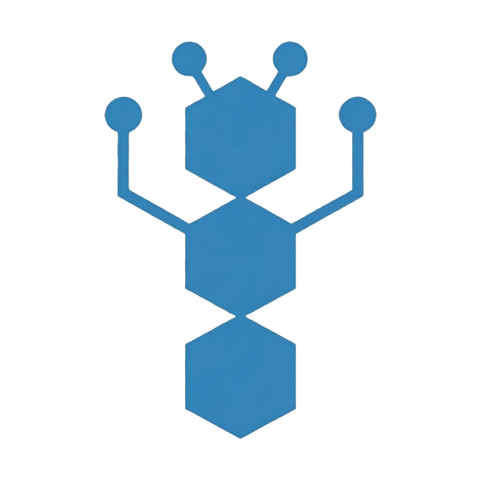

<!--
  SPDX-License-Identifier: Apache-2.0
  Copyright 2026 Fabio Marcello Salvadori
-->

<p align="center">
  
</p>

<h1 align="center">NCP: Neural Computation Protocol</h1>

<p align="center">
  <strong>Faster AI agents. Fewer tokens. Reusable workflows.</strong>
</p>

<p align="center">
  <a href="https://github.com/madeinplutofabio/neural-computation-protocol/actions/workflows/validate.yml"></a>&nbsp;<a href="https://crates.io/crates/ncp-runtime"></a>&nbsp;<a href="https://crates.io/crates/ncp-mcp-server"></a>&nbsp;<a href="https://pypi.org/project/ncp-runtime/"></a>&nbsp;<a href="https://pypi.org/project/ncp-langgraph/"></a>&nbsp;<a href="https://opensource.org/licenses/Apache-2.0"></a>
</p>

---

Not everything an AI agent does needs an AI model.

Many agents use expensive language-model calls for routine work that ordinary software could handle faster, more cheaply, and with more predictable results. NCP lets developers turn that work into reusable, sandboxed workflows that run across different AI systems.

Use AI when you need intelligence. Use NCP when you need fast, predictable, repeatable computation.

## What the benchmarks show

When an agent stops calling a language model for work that does not need one, the difference can be dramatic.

NCP's reference benchmark uses a 200 ms **simulated** LLM response and measures end-to-end average response time for a mixed workload where only a fraction of inputs escalate to the model:

| Requests handled without an LLM | Average response time | Vs LLM-only |
|---|---|---|
| 0% (LLM-only baseline) | 200.6 ms | baseline |
| 50% | 100.3 ms | ~2x faster |
| 90% | 20.1 ms | **~10x faster** |
| 97% | 6.1 ms | **~33x faster** |

Runtime overhead itself is tiny: a single-step workflow with a trivial Brick measured a median of 15 microseconds on Linux/WSL2 in the same benchmark.

Cost follows the call count: for workloads where model calls dominate spending, avoiding 90% of those calls reduces that portion of the bill by roughly 90%, before other compute and infrastructure costs.

These are reproducible synthetic results. Real-world speedups and savings depend on how much of your workload can be handled reliably without an LLM. Full methodology and raw results: [BENCHMARK.md](BENCHMARK.md) and [COST_MODEL.md](COST_MODEL.md).

## Why NCP?

- **Lower AI costs.** Avoid unnecessary language-model calls for routine work. Fewer calls, fewer tokens billed.
- **Faster responses.** Deterministic tasks finish without waiting for model inference.
- **Build once, reuse across agents.** Package and version workflows for Python, MCP, and LangGraph instead of rebuilding the same logic in every application.
- **Sandboxed by design.** Each Brick runs in a WebAssembly sandbox with an empty import surface (no filesystem, no network, no WASI) and explicit memory + output-size limits. Not a claim that any third-party code is safe to execute; it is a meaningful reduction in what a Brick can do by default.
- **Predictable and traceable.** Deterministic Bricks produce repeatable results for the same inputs and execution conditions, and the runtime emits a line-oriented execution trace you can inspect.
- **Local-first and open source.** Run on your own infrastructure. No hosted NCP service, no central workflow registry, no account to create.

## A practical example

Your company has four AI agents: one on the website, one in the CRM, one supporting customers, one used by partners. All four need to apply the same lead-qualification rules.

You could reimplement those rules in every agent (four codebases, four sets of edge cases) or you could call an LLM every time (slower, more expensive, less consistent).

With NCP, your developers package the qualification rules as Bricks wired into a graph, publish it as a versioned workflow archive, and every agent runs the same installed workflow by name, through Python, through MCP, or through LangGraph. Fewer unnecessary AI calls, one shared implementation, consistent outcomes.

A working two-Brick version of this example lives at [`examples/graphs/lead-qualification/`](examples/graphs/lead-qualification/), including 11 reproducible fixtures.

## Why not just use Python?

You can. If one application needs a handful of rules, ordinary Python functions are enough.

NCP earns its place when the same capability is needed by several agents, by agents that use different frameworks, or by another team that wants to reuse your logic without copying code, rebuilding dependencies, or maintaining separate integrations. Then it helps to package the logic once, distribute it, install specific versions side by side, and run it the same way from Python, from MCP, and from LangGraph.

## Quick start

Install the Python SDK (which bundles the `ncp` runtime binary on supported platforms) and run the onboarding smoke:

```bash
pip install 'ncp-runtime[workflows]'
python -m ncp_runtime.demo
```

That resolves the bundled binary, runs a tiny built-in graph, and prints `result_type` plus a one-line summary per terminal. Exit 0 on `Success`.

To go further, follow the end-to-end **producer + consumer walkthrough** at [`examples/workflows/README.md`](examples/workflows/README.md): package your own graph into a versioned archive, publish its SHA-256, install it in a fresh environment, and run it by name from Python, MCP, or LangGraph.

> **Security note.** Archive SHA-256 verification proves integrity against the publisher's supplied digest. It does not authenticate the publisher and is not a claim that the workflow is safe to execute. Sandboxing limits what a Brick can do; it is not the same as trusting its author.

## Documentation

- [Python SDK reference](docs/PYTHON_SDK.md)
- [MCP adapter reference](docs/MCP_ADAPTER.md)
- [LangGraph adapter reference](docs/LANGGRAPH_ADAPTER.md)
- [Workflow packaging and consumption](examples/workflows/README.md)
- [Protocol specification](spec/ncp-v0.2.3.md)
- [Compatibility and versioning policy](docs/COMPATIBILITY.md)
- [Install guide](docs/INSTALL.md)
- [Benchmarks and methodology](BENCHMARK.md) + [Cost model](COST_MODEL.md)
- [Roadmap](docs/ROADMAP.md)
- [Contributing](CONTRIBUTING.md)

## Repository layout

| Path | Contents |
|---|---|
| `runtime/` | Rust execution runtime |
| `crates/ncp-mcp-server/` | MCP server crate |
| `bricks/` | Reference brick crates |
| `python/ncp-runtime/` | Python SDK (bundles the runtime binary) |
| `python/ncp-langgraph/` | LangGraph adapter |
| `examples/` | Graphs, bricks, workflows, and integration demos |
| `spec/` | Protocol specification |
| `docs/` | Design docs, roadmap, adapter guides, compatibility matrix |

## Get involved

Issues and discussions live on GitHub. The contribution guide is in [CONTRIBUTING.md](CONTRIBUTING.md). All commits require a [DCO sign-off](https://developercertificate.org/) (`git commit -s`).

## License

Apache 2.0. See [LICENSE](LICENSE) and [NOTICE](NOTICE).
